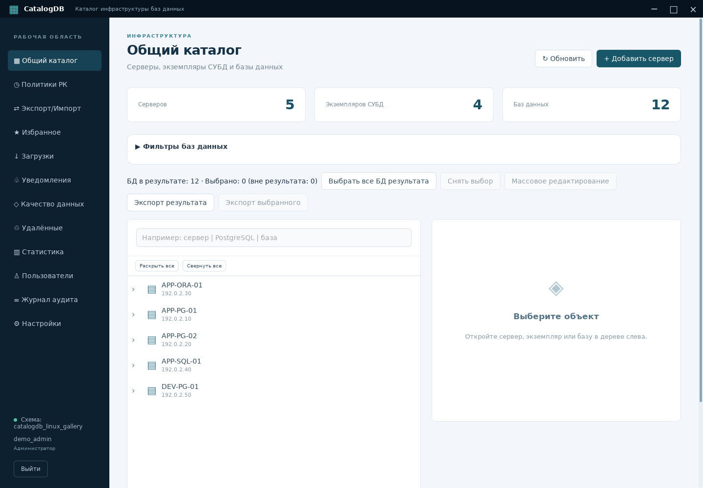
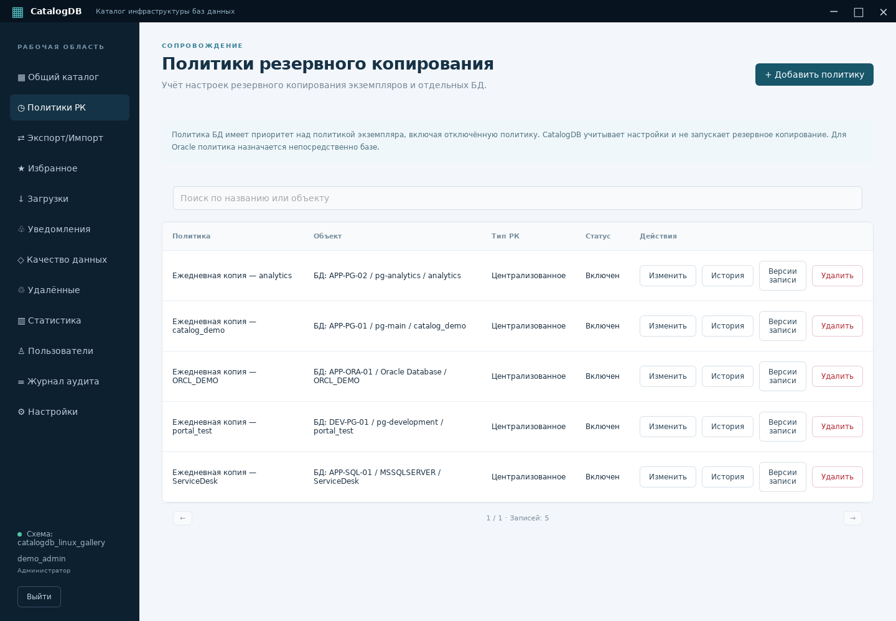
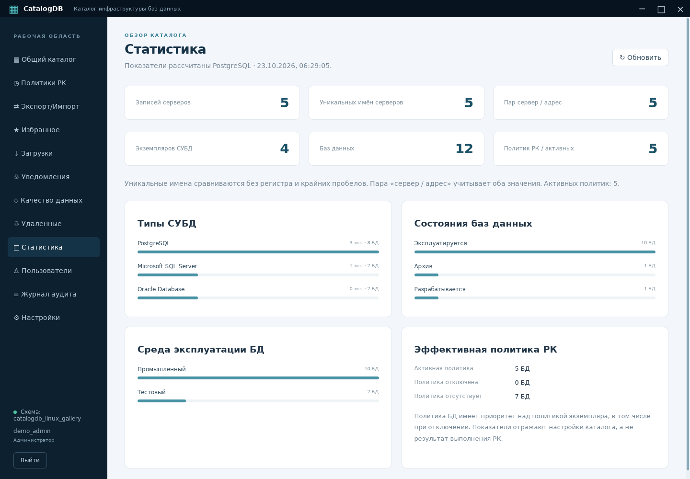
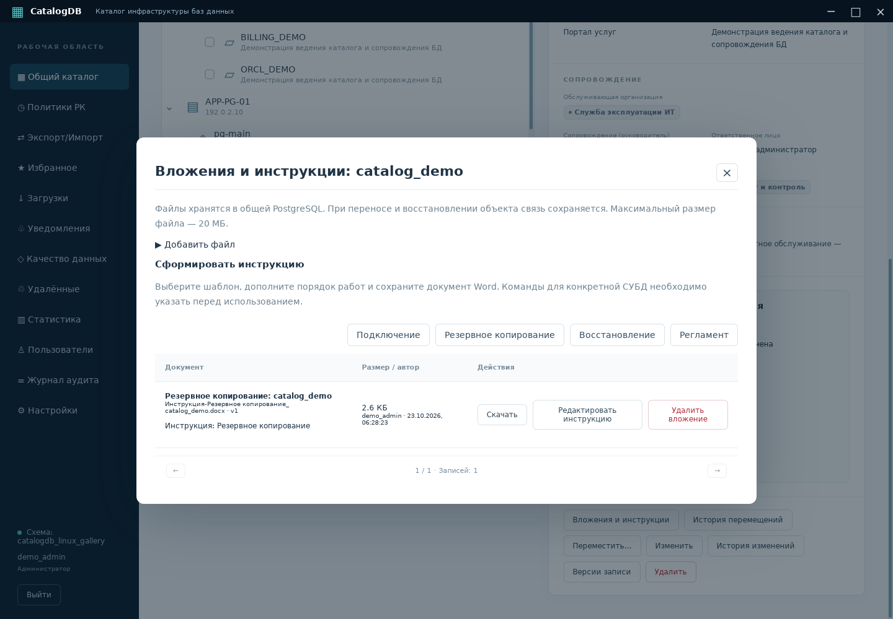
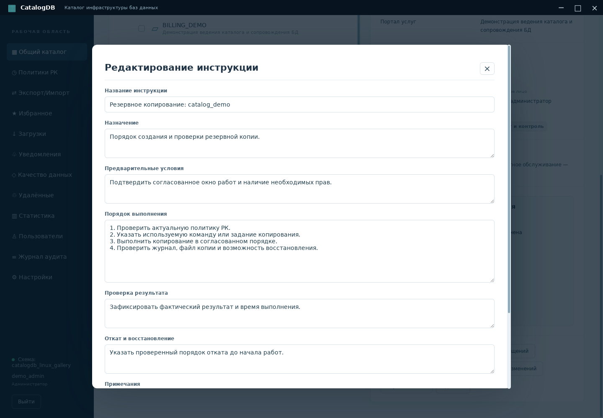
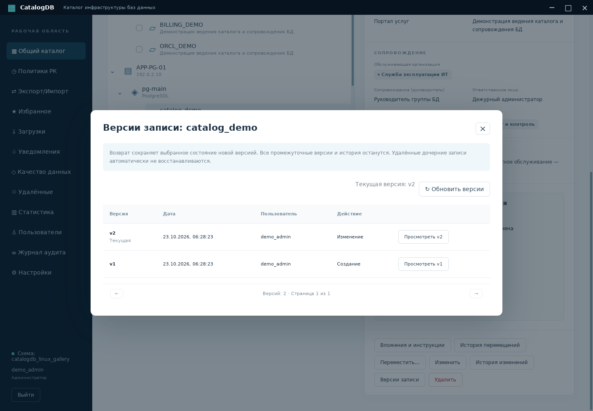
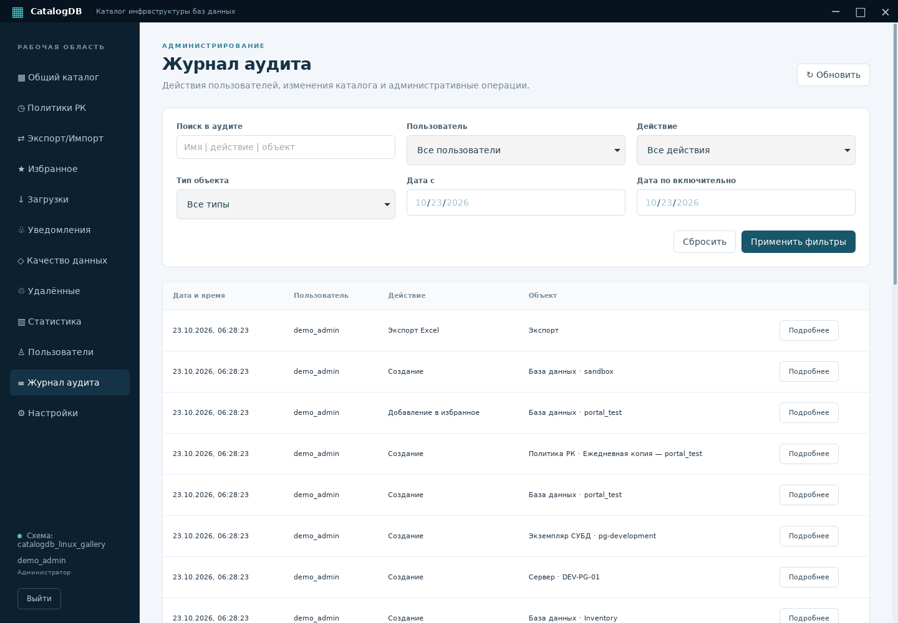
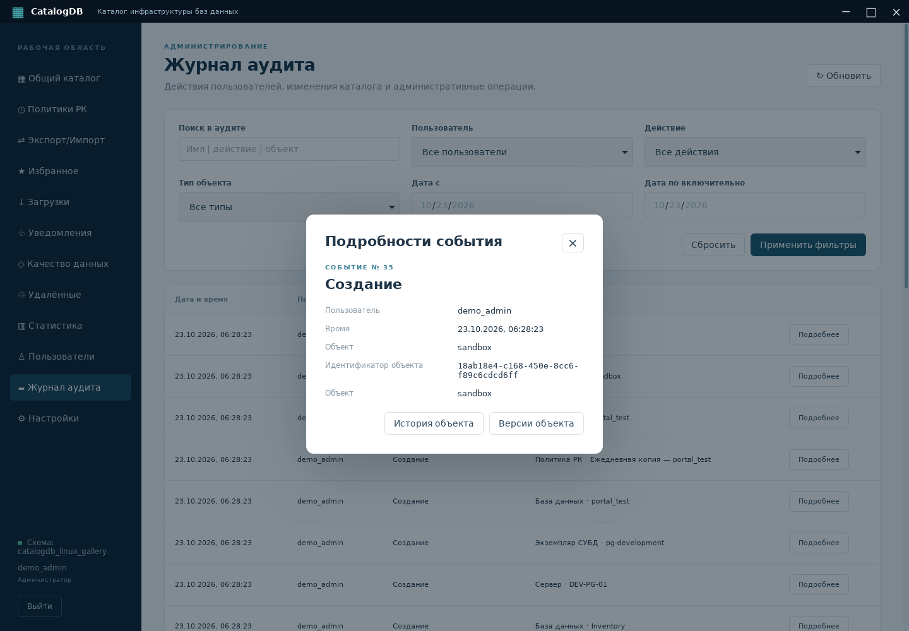
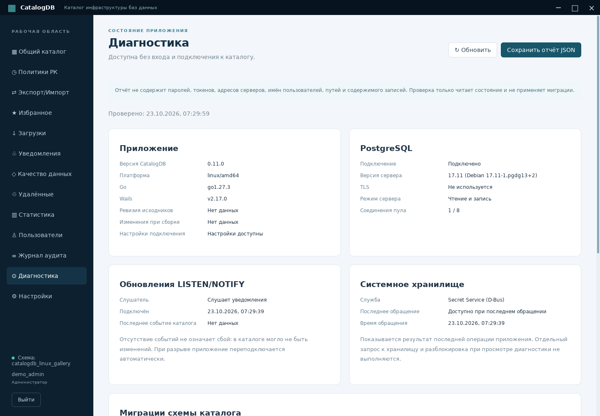

# CatalogDB в Linux — скриншоты

Настоящая Linux x64 сборка CatalogDB 0.10.0 (для снимка диагностики — 0.11.0), запущенная в Debian 13:
Wails 2.17.0, GTK 3, WebKitGTK 4.1, PostgreSQL 17. Снимки сделаны
23 октября 2026 года из окна приложения размером 1440 × 1000 под Xvfb.
Это облачная графическая сессия, без оформления GNOME/KDE.

Каталог демонстрационный: все названия, организации и записи вымышлены.
Адреса 192.0.2.0/24 предназначены для примеров. Рабочие данные и учётные
данные пользователя не использовались. Приложение работает с отдельной
демонстрационной схемой PostgreSQL; Wails bridge и backend не подменяются.

## Общий каталог

Пять серверов, четыре экземпляра и двенадцать баз данных. Ветки изначально свёрнуты.

## Карточка базы данных и дерево Oracle

Раскрыто дерево каталога. Oracle Database размещается непосредственно под
сервером; обычные базы — внутри экземпляров. Справа — сопровождение,
цветные метки и политика резервного копирования выбранной БД.

## Политики резервного копирования

## Статистика

Показатели и распределения рассчитаны PostgreSQL по демонстрационным записям.

## Вложения и инструкции

Сохранённая инструкция Word связана с конкретной базой данных.

## Редактирование инструкции

## Версии записи

Создание и изменение демонстрационной БД представлены отдельными версиями.

## Журнал аудита

## Подробности события

[Скачать Linux-сборку](https://github.com/yomezza/test/releases/tag/v0.10.0) ·
[Запуск и зависимости](linux.md)

## Диагностика (0.11.0)

