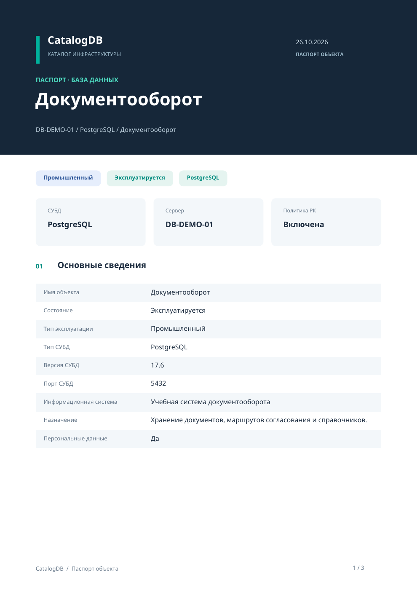

# Печать объекта в PDF

Начиная с 0.14.0, сервер, экземпляр СУБД или базу данных можно оформить как PDF-паспорт. Откройте карточку и нажмите **«Печать в PDF»**. То же действие есть в меню ПКМ, а на Android — в меню **⋮**.

PDF автоматически сохраняется в **«Загрузки»**, затем открывается системный диалог сохранения копии. Если отменить диалог, паспорт останется в загрузках: его можно открыть, сохранить повторно или отправить через «Поделиться» на Android. Команда не запускает физический принтер.

## Содержание

- Название, путь в каталоге, состояние и тип эксплуатации.
- Для БД и экземпляра — тип и версия СУБД, порт; для БД также информационная система, назначение и сведения о персональных данных.
- Родительский сервер, адрес, размещение, способ подключения, домен и ОС.
- Организация, руководитель, ответственное лицо и работы АБД из карточки выбранного объекта.
- Собственная или унаследованная политика резервного копирования. Отключённая собственная политика перекрывает политику экземпляра.
- Для сервера — число экземпляров и БД, включая Oracle SID; для экземпляра — число БД. Полный список дочерних объектов в паспорт не включается.
- Описание, UUID и версия записи, автор и время формирования с часовым смещением.

Oracle SID размещается непосредственно на сервере: паспорт не создаёт и не требует фиктивный экземпляр. Значение «Не указано» обозначает незаполненное поле; чужие ответственные автоматически не наследуются.

Отчёт формируется по актуальному состоянию PostgreSQL в одной транзакции с согласованным снимком, независимо от загруженных страниц каталога. Он доступен всем активным прикладным ролям, включая наблюдателя; неавторизованные и заблокированные пользователи не могут его сформировать. Формирование записывается в аудит.

## Оформление и ограничения

Формат A4: фирменная шапка, цветные метки, сводные блоки, разделы и нумерация страниц. Кириллические шрифты Noto Sans встроены в документ; интернет, браузерный движок печати и установленные в ОС шрифты не нужны. Текст можно выделять и искать. Длинные значения и описания переносятся на следующие страницы без усечения; обычные разделы по возможности остаются целиком на одной странице.

Паспорт описывает сведения каталога и настройки РК, а не фактическую доступность инфраструктуры или успешность резервных копий. Вложения и история не встраиваются. Пароли и токены подключения не включаются; содержимое явно заполненных пользователем текстовых полей выводится как текст. Символы вне BMP, включая многие эмодзи, заменяются знаком замены; это ограничение PDF-движка. Электронная подпись и PDF/A не реализованы.

[Демонстрационный PDF](examples/CatalogDB-passport-demo.pdf) содержит только вымышленные сведения.

Реализация: `internal/reports` — независимый генератор PDF; `internal/application/passport.go` — авторизация и загрузка данных; Wails и Android используют одну реализацию. Новых SQL-миграций нет, схема остаётся 016.
