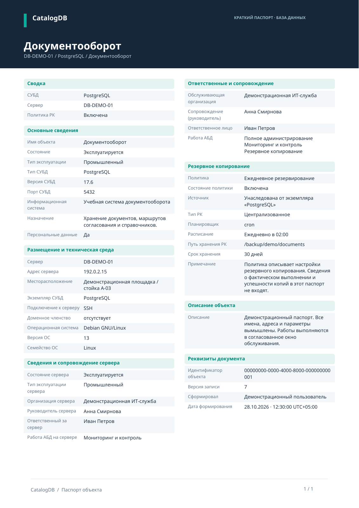

# Печать объектов и выбранных БД в PDF

С версии 0.15.0 перед формированием PDF открывается окно параметров. Физическая печать пока не запускается.

## Один объект

Откройте карточку сервера, экземпляра или БД и нажмите **«Печать в PDF»**. То же действие есть в меню ПКМ, на Android — в меню **⋮**.

## Несколько БД в одном файле

1. Отметьте БД флажками в общем каталоге. Можно использовать **«Выбрать все БД результата»**.
2. Нажмите **«Печать выбранных БД»** рядом с экспортом выбранного в XLSX.
3. Выберите вид паспорта и необходимость включения политик РК.
4. Нажмите **«Сохранить PDF»**.

Все отмеченные БД объединяются в один файл. Учитываются выбранные записи вне текущего поиска, фильтра и загруженной страницы; одноимённые SID разных родителей остаются отдельными объектами. Порядок — сервер, экземпляр и имя БД. До **500 БД в одном PDF**; превышение требует уменьшить выбор, без молчаливого усечения.

## Подробный и краткий вид

| Вид | Результат |
| --- | --- |
| **Подробный** | Фирменная обложка, цветные статусы, сводные блоки и разделы. Каждый объект начинается с новой страницы, длинный текст переносится дальше. |
| **Краткий** | Один объект на одной странице A4: тёмная шапка и две компактные колонки со всеми сведениями выбранного паспорта. Для N БД получается ровно N страниц. |

В кратком виде размер основного текста подбирается от 9 до 7 pt. Строки не обрезаются и не заменяются многоточиями. Если весь текст не помещается даже при 7 pt, PDF не создаётся: окно укажет объект и предложит подробный вид. Ошибка одной записи не оставляет частичный файл; можно поменять режим и повторить.

## Флажок политик РК

**«Включать политики резервного копирования»** по умолчанию включён. При отключении из каждого паспорта исчезают раздел РК и показатель политики в сводке. Имена, пути, расписания, описания и состояние политик не включаются в PDF. Другие поля, например вид работы АБД «Резервное копирование», сохраняются.

При включении показывается эффективная политика: собственная политика БД, включая отключённую, перекрывает унаследованную от экземпляра. Oracle SID размещается непосредственно на сервере и не требует фиктивного экземпляра.

## Содержание и сохранение

В паспорт входят название и путь, состояние и тип эксплуатации, параметры СУБД, информационная система, назначение, сведения о персональных данных, размещение, адрес и ОС сервера. Параметры сопровождения сервера выводятся отдельно от ответственных выбранной БД. Также включаются описание, UUID/версия записи, автор и время формирования с часовым смещением. Для сервера/экземпляра показываются количества детей; полный список детей не встраивается.

PDF сначала сохраняется в **«Загрузки»**, затем открывается системный диалог сохранения копии. При отмене диалога файл остаётся доступным. На Android можно передать его через **«Поделиться»**. Отмена окна параметров не создаёт файл.

Данные всей подборки и эффективные политики читаются в одной авторизованной транзакции PostgreSQL, независимо от страниц UI. Удалённая или недоступная БД отменяет всю подборку. Активный наблюдатель может печатать; заблокированный пользователь — нет. Аудит фиксирует количество объектов, вид PDF и включение политик.

## Примеры

Все сведения вымышлены:

- [Подробный паспорт](examples/CatalogDB-passport-demo.pdf).
- [Краткий паспорт — одна страница](examples/CatalogDB-passport-compact-demo.pdf).
- [Две выбранные БД — один файл, две страницы](examples/CatalogDB-passports-selected-demo.pdf).

Кириллические Noto Sans встроены; интернет, браузерный движок печати и установленные в ОС шрифты не требуются. Текст можно выделять и искать. Паспорт отражает сведения каталога и настройки РК, а не фактическую доступность объектов или успешность копий. Вложения и история не встраиваются. Пароли подключения и токены не включаются; заполненные пользователем текстовые поля выводятся как текст. Символы вне BMP заменяются знаком замены. PDF/A и электронная подпись не реализованы.

Реализация: `internal/reports` — оба макета и общий многообъектный PDF; `internal/application/passport_export.go` — подборка, параметры и сохранение; `passport.go` — модель паспорта. Wails и Android используют один Go service. Схема PostgreSQL остаётся 016.
