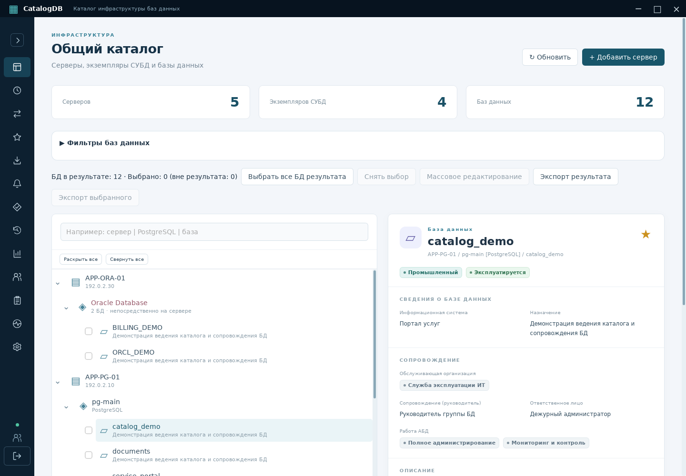

# Проверка CatalogDB 0.12.0

Дата: 23 октября 2026 года. Исходники изменения интерфейса: `d308eaa`.

## Рабочая область

- Кнопка со стрелкой рядом с заголовком сворачивает панель до 72 px; повторное нажатие раскрывает её.
- Выбор хранится локально в WebView. При недоступности localStorage переключение продолжает работать до закрытия приложения.
- Названия разделов доступны в подсказках и для средств доступности. Административные разделы по-прежнему зависят от роли.
- Активный раздел, счётчик непрочитанных сообщений, состояние подключения и выход остаются доступны в компактном виде.
- Состояние схемы и пользователь доступны через подсказки к индикаторам. Длинный счётчик отображается как 99+, полное значение сохраняется в доступном описании.
- Область навигации прокручивается независимо; выход остаётся доступен на небольшом окне. Кнопка сворачивания работает с клавиатуры.

## Выполненные проверки

- `go test -race ./...` с отдельной тестовой PostgreSQL 17 — пройдено, включая интеграционные проверки.
- `go vet ./...` — пройдено.
- TypeScript и production-сборка Vite — пройдены.
- Vitest — 14 тестов пройдены.
- Playwright — проверены 44 сценария; файл подключения с двумя новыми сценариями повторно пройден целиком (4/4). Проверяются изменение доступной ширины, навигация по иконкам, сохранение после перезагрузки, клавиатура и запрет localStorage.
- Собраны Windows x64 EXE и Linux x64 ELF через Wails 2.17.0 и Go 1.27.3 с общими frontend-ресурсами.
- Настоящая Linux-сборка запущена в Debian 13 / GTK 3 / WebKitGTK 4.1, с PostgreSQL и системным хранилищем. Проверены сворачивание, выбор карточки, окно 960 × 640 и сохранение компактного режима после полного перезапуска процесса.

Снимок сделан в окне 1440 × 1000. Каталог демонстрационный, записи вымышлены. Содержимое карточек и обработчики Go не подменяются.

## Совместимость

Новых миграций нет: используется схема 016. Поведение авторизации и модель прав PostgreSQL не изменялись. Обновлены адреса публикации после переименования репозитория в `yomezza/dbcatalog`.

Linux-архив требует glibc 2.41+, GTK 3 и WebKitGTK 4.1, как и предыдущая облачная сборка. Windows EXE собран кросс-компиляцией; новый интерактивный прогон на Windows в этой среде не выполнялся.
